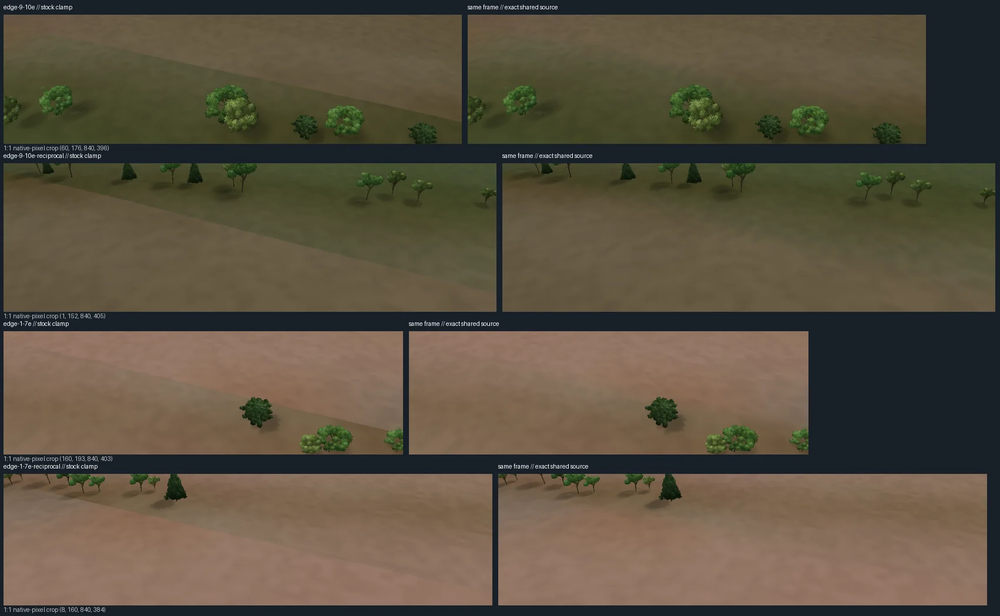

# Two western PEI field-image joins

Two straight grid lines that cut across dry PEI fields now use neighbouring
original image texels where the existing near-detail tiles meet. The narrow
blend does not straighten a field boundary, repaint the ground or change
terrain height. It adds no imagery download. The rest of the flight map
continues to use its existing surface.

The same Copernicus Sentinel‑2 L2A natural-colour sources are already used
in the [world atlas](../WORLD.md). Each window authenticates both original
tile bodies and the underlying signed dry Cover. The two owners must be
visible and ready at the near terrain level; a stale, missing or wrong
source returns to stock. Each window has a fixed end taper and no effect
at altitude, outside the bounded rows, or through an unmatched orientation.
Trees, roads, buildings, contact and flight dynamics are unchanged. The
source images do not establish present-day field boundaries.

| Existing owner pair | Original north-origin rows | Median cross-edge RGB distance, before → after |
| --- | --- | --- |
| `9-10 / 10-10` | `[597, 617)` | 18.26 → 1.85 forward; 21.29 → 2.26 reciprocal |
| `1-7 / 2-7` | `[553, 573)` | 11.31 → 1.32 forward; 13.92 → 1.69 reciprocal |

The four close WebGL2 inspection frames used two-color support masks with
four samples per pixel. They showed no RGB change outside the independently
registered role, no new sky, no alpha or draw-count change, and exact render
rollback. Six high, side and reversed controls reproduced every stock PNG
byte; two existing active atlas joins reproduced independent stock PNGs.
The [signed-source and inspection receipt](western-field-joins-proof.json)
records the hash locks and native evidence.

Two separate compiled Chase runs advanced the real flight simulation past
the registered sites. The first two moving views at each site retained
the verified local improvement, including unchanged alpha and exact
rollback. The two later views at each site were exact stock once the
window left view. No shader added a draw call or triangle.
