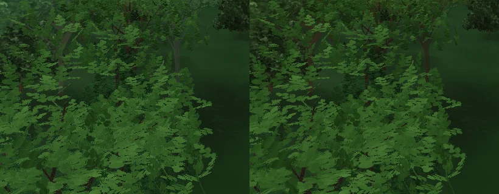

# Preserve scene opacity through near woodland

The optional **Woodland scenery view** and **near branched woodland**
already replace part of the distant canopy with real trunks, branches
and layered leaf clusters. Both the near draw and its handoff to the
billboard canopy use partial alpha for multisample coverage. That value
should not leave the world canvas translucent. Both draws now preserve
the alpha already written by the scene, while retaining the original
covered samples and RGB replacement.

The tree roster, geometry, shaders, bark and ground materials, and
transparent shadows are unchanged. The view culler still checks the
exact material contract and retains its original bounded submission.
Contexts without a multisampled alpha framebuffer keep the original
blend state; the already established billboard fallback without
multisampling is unchanged. No art or requests are added. Ordinary
Standard when the option is off is unchanged.

Diagnostic: unscaled crops from the same fixed Queens County camera,
each composited offline over the same slate color. Raw WebGL readback in
Queens and Prince closed **88,467** and **88,144** nonopaque pixels
respectively, with zero framebuffer RGB changes and unchanged geometry and
draw counts. Both comparisons held the view-culling setting fixed and
restored the exact old frame. One separate ordinary Queens flight
switched to Scenery and paused, with both new four-sample blend states
and the existing view culler operating on the actual submitted draws. A
separate forced zero-sample flight kept only the original canopy and
legacy blend, and also paused normally.

[Machine-readable verification](woodland-coverage-alpha/verification.json)
