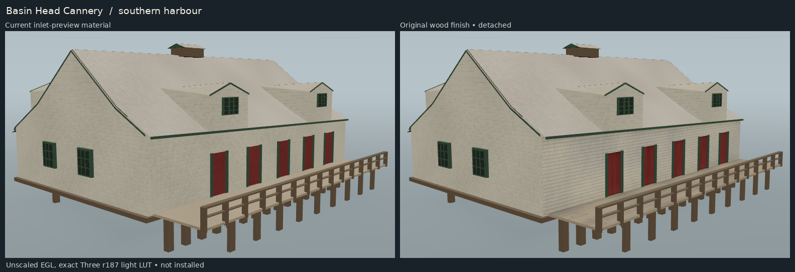
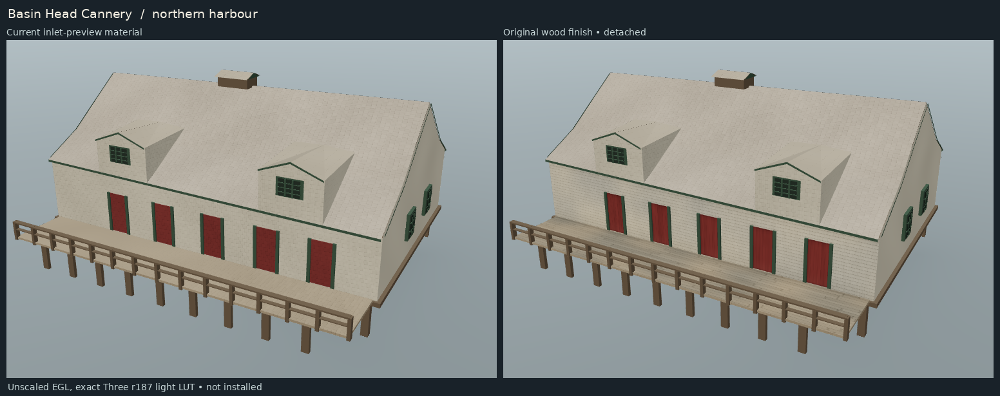

# Basin Head Cannery · working harbour face

The existing **Basin Head · low pass** can show the Cannery when the
separate **Open inlet preview** is selected. This detached study improves
the appearance of its long wall, original five red doors and inner
working apron. The separate [explicit finish option](../../../docs/qa/basin-cannery-finish-preview.md)
uses these materials; the original inlet option still opens without them.

| Original material vs the detached finish |
| --- |
|  |
|  |

The [Canadian Register of Historic Places](https://www.historicplaces.ca/en/rep-reg/place-lieu.aspx?id=7436)
documents wooden shingles, the five solid wooden harbour doors, the
pilings, gable and dormers. The [National Trust exterior reference](https://nationaltrustcanada.ca/online-stories/sun-salt-and-shorelines-discovering-the-spirit-of-summer-at-canadas-passport-places)
helps distinguish the warm pale walls, muted trim and red doors. No
photo pixels or measurements from that photograph are incorporated.
Paint wear, shingle overlaps and the plank finish are original
interpretations, not precise observations of current materials,
construction, wall bearings or working surfaces.

The existing [Cannery source and placement](../../../docs/qa/basin-head-cannery.md)
remain authoritative. Its original outlines and geodata attribution
are unmodified. The study does not add doors or depict an interior;
roof, windows, rail, piles, coast, grade and bridge are held to the
original model. Only 14 original triangles receive the effect:

| Actual input | Original non-indexed vertex range | Simulated surface area |
| --- | ---: | ---: |
| Harbour wall | [54, 60) | 59.906 m² |
| The five closed doors | [0, 30) | 11.233 m² |
| Inner apron top | [24, 30) | 54.947 m² |

`basin-waterfront-finish.ts` authenticates the exact geometry/material
owners before preparing the optional shader. It adds no geometry,
textures, framebuffers, map requests or drawn objects to that maker.
The authored shader does not alter output alpha, write depth,
displace vertices, or load a new sampler. Actual device cost and
appearance in the coupled inlet scene have not been measured.

## Corrected detached optical proof

The original detached EGL harness produced real drift even when the
stock image was rendered twice with identical inputs. It left an
active r187 `dfgLUT` sampler on unit 0, where the previous frame’s
resolve texture was bound. The [earlier receipt](evidence/earlier-harness-held.json)
is retained as a failed fixture, not evidence that the game leaked
out of the material scope. Do not use its crops as lighting references.

These published unscaled comparisons bind the exact 16 × 16 r187 lookup
as RG16F, independent of the separate RGBA8 resolve. The active sampler
is bound to unit 5 and checked after link. The [corrected native receipt](evidence/detached-egl.json)
records actual 4× RGBA8/D24 and 31 permutations per pose, including
cold stock, gain zero, active, the first direct and linked stock
rollbacks, and the original depth roles.

| Detached view | RGB difference over 3 | Exterior / alpha changes |
| --- | ---: | ---: |
| Southern harbour | 40,998 | 0 / 0 |
| Northern harbour | 49,814 | 0 / 0 |
| Turned away | 0 | 0 / 0 |

The nearby water and the full terrain/aircraft context are not part
of these studio renders. In-flight work needs matched ordinary frames
with the real inlet option; the former archived route confirms visibility
only, not this new material. No game deployment or installation is made
by this package.

## Reproduce

From the repository root with the existing Three r187 dependencies,
Python, NumPy/Pillow, and Mesa EGL. DejaVu Sans is only needed to
regenerate optional captioned plates.

```sh
study=tools/art/basin-head-cannery-finish
lut=$(mktemp -d)
node tools/art/summerside-station/roof-finish/qa/export-dfg.mjs "$lut"
node --experimental-transform-types --test "$study/qa/front.test.mjs"
node --experimental-transform-types "$study/qa/export.mjs" /tmp/pei-basin-input
python "$study/qa/fixed-proof.py" /tmp/pei-basin-input /tmp/pei-basin-output "$lut"
python "$study/qa/plates.py" /tmp/pei-basin-output /tmp/pei-basin-plates
```
