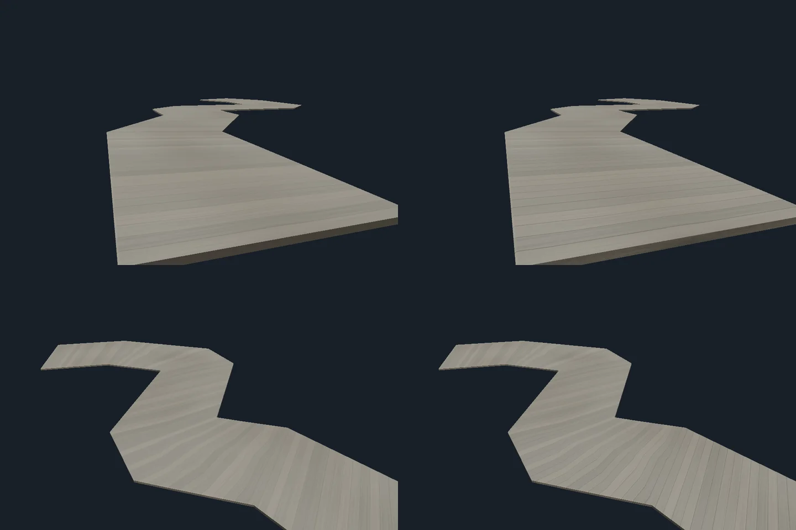

# Timber boardwalk kit

This standalone Three.js tool makes a low timber deck from a caller-supplied, registered centreline and unchanged visual ground. It does not load maps, fit elevations, act as a bridge, generate collision or add scenery to flights.



## Geometry and material

The builder emits two indexed draws: the deck and its closed edge/underside. A caller must confirm the entire footprint of every triangle is dry, including its edges. The builder rejects overlapping swept footprints, invalid segments and slopes or clearances beyond the supported range. Its fixed probes are safeguards, not a substitute for a complete survey or an unfailing clearance guarantee between samples.

The original timber finish uses short procedural colour variations, grain and analytically filtered transverse seams. The optional relief adds fine groove shading and terminal edge treatment without extra textures, attributes or draws. The pictured 26.93-metre path is synthetic: sharp turns use mathematical mitres and bevels, not a known real joint, lookout or landing.

## Source reference and placement hold

[North Rustico's 2024 Seawalk procurement](https://northrustico.com/wp-content/uploads/2024/10/242648.00-IFAT-Tender-Docs.pdf) and [amendment](https://northrustico.com/wp-content/uploads/2024/10/242648.00-Addendum-1-Final.pdf) describe the use of timber decking on sleepers and granular fill. The typical 3-metre design width and nominal 8-inch timber informed the detached comparison. Neither is asserted as a measurement of the rebuilt boardwalk. The [town's September 2025 meeting packet](https://northrustico.com/wp-content/uploads/2025/10/Appproved-Minutes-Full-Package-Sept-2025.pdf) records substantial completion on August 12, 2025. The published tender is not the signed as-built survey.

The older public route and the provincial trail layer disagree by several metres on much of the North Rustico promenade; neither resolves its current edges or contact with the game terrain. No provider vectors, photographs or property-specific geometry are included, and the kit is not installed on that promenade or anywhere else in the simulator.

## Verify

```sh
node --experimental-strip-types --test tools/art/boardwalk-timber/*.test.mjs
```

The tests cover exact closed geometry, join winding, dry and steep-ground refusal, an indexed synthetic 950-metre budget check and the wood filter. The [four-view software render receipt](timber-render-receipt.json) compares materials on the same synthetic geometry. It does not measure hardware performance or player visibility.
