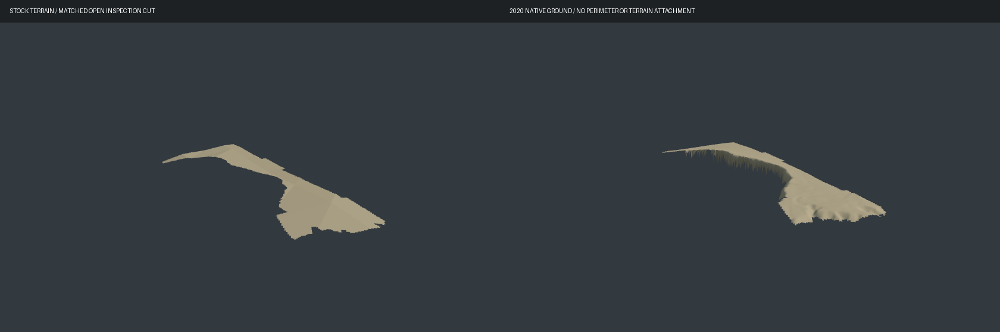

# Cape Tryon dry crest: measured shape and a placement hold

The verified 2020 bare-earth data reveal more relief than the existing
game terrain at this Queens County crest. The comparison below is an
isolated open cut, not a playable change or an ordinary flight capture.

**Stock reconstructed surface, left; dated measured surface, right**

The original [Cape Tryon crest observation](../../../docs/qa/cape-tryon-dated-crest.md)
published summary measurements, not a native image or mesh. The new
[source custody](source/custody.json) records a recovered, unresampled
516 × 448 Float32 chip, SHA-256
`e25dd8e9ce83d801828c560d71804903069b2071088c11381d35c7d6bcd191c2`.
This is numerical bare earth from
[Natural Resources Canada’s PEI 2020 1 m HRDEM](https://datacube.services.geo.ca/pgstac/api/collections/hrdem-lidar/items/PEI-Prince_Edward_Island_2020-1m),
horizontal EPSG:3979 and orthometric CGVD2013. Contains information
licensed under the [Open Government Licence – Canada](https://open.canada.ca/en/open-government-licence-canada).
No aerial photo or web basemap image was captured. The acquisition
script pins the old object and range responses and refuses to fetch a
full raster. The publication contains the witness, not a donor tile.

The [dry screen](dry-screen.json) admits 11,759 full class-30 cells in
one original-coast dry component. The comparison clips both triangulations
to the same roughly 11,528 m² footprint. The [gentler 9,890-cell
subset](low-slope-core.json) still sits at least **2.35 m higher** than
stock along its entire perimeter, even between metre centres. None of
its 1,078 perimeter edges achieved the ±0.20 m tie. Separately, the
full inspection cut crosses six mapped road-centre segments and the
bounds of one signed building footprint. Those peers are unrendered
in the comparison, not assumed absent.

The [second view](optics/east-matched.webp) changes the silhouette and
shading, but missed the declared 9,500-pixel source coverage threshold
(8,972 observed). Both studio views restore exactly with no changes
outside their two silhouette masks. They reuse archived eye positions,
then re-aim at the isolated cut; the original lens aim, water, roads,
buildings and flight scene are not reproduced. See the
[paired-render receipt](optics/receipt.json).

**Do not install this cut.** A placement candidate needs a surveyed
landward continuation to a genuine join, exact road and building
protection, and two actual flight views. Neither the existing sandstone
finish, coastline nor aircraft contact was changed.
