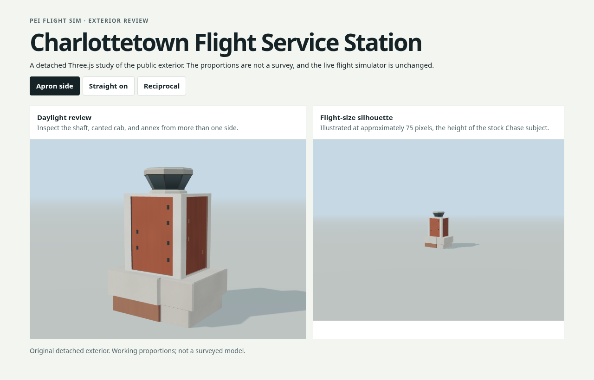

# Charlottetown Flight Service Station exterior study

A separate original Three.js model of the former control-tower exterior at Charlottetown Airport. This directory does not replace the building in the simulator or reproduce any operational or interior details. Dimensions, pane division and the unobserved sides are working proportions, not a survey.

The [airport’s daylight exterior](https://flyyyg.com/wp-content/uploads/2020/06/media-yyg-tower.jpg) shows the red shaft panels, pale shoulders and dark outward-sloping cab. [NAV CANADA’s dated September 2022 photograph](https://www.navcanada.ca/en/news/blog/hurricane-fiona-how-aviation-professionals-weathered-the-storm--.aspx) independently identifies the Flight Service Station and shows the distinct lower mass. The original combined tower and operations building was completed in 1984, according to [Environment Canada’s historical construction log, Appendix I](https://publications.gc.ca/collections/collection_2025/eccc/en37/En37-643-1989-eng.pdf). These support identity, broad silhouette and materials. They do not certify current measurements or condition. No photograph pixels or borrowed texture assets are in the model.

The neutral review scene shows three close angles and the same model at the approximate 75-pixel height of the stock Chase subject. The latter is a scale check, not a flight replay. The existing live batch stays stock until the shaft, cab, lower mass, terrain seat, and adjacent owners can be verified separately. Preview geometry is not a collision model.



The model uses two opaque meshes. The close level has 618 triangles and the mid level has 426. The lower-detail version retains the same main silhouette and broad recesses. The glass uses a subdued original daylight response, not a photograph, transparency or an interior model.

## Open the studio

From the repository root after `npm ci`:

```sh
./node_modules/.bin/vite tools/art/charlottetown-fss-exterior --host 127.0.0.1
```

The review scenes are local only. Use the named camera buttons for matching material and silhouette checks.


For the deterministic desktop and small-viewport capture, with Python Playwright and a Chromium executable:

```sh
./node_modules/.bin/vite build tools/art/charlottetown-fss-exterior --base ./
python tools/art/charlottetown-fss-exterior/capture.py --checkout tools/art/charlottetown-fss-exterior --out /tmp/pei-fss-review --chromium /path/to/chromium
node --experimental-strip-types --test tools/art/charlottetown-fss-exterior/fss-exterior.test.mjs
```
