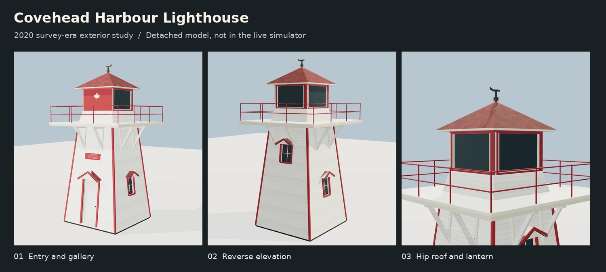

# Covehead Harbour Lighthouse: detached art study

**Not in the flight simulator.** This is an editable, metre-scale Three.js
exterior study, not deployed scenery. It does not replace buildings, change
collision or terrain, or add a Dispatch destination. It does not model the
light signal, wharf, walks, vegetation, later shoreline or current site.



## Source and known limits

- The [federal heritage description](https://www.pc.gc.ca/apps/dfhd/page_hl_eng.aspx?id=14994)
  identifies the tapered square tower and its distinctive lantern and gallery.
  The 8.2 m designation height and the [Coast Guard focal elevation](https://notmar.gc.ca/publications/list-lights/atl/atl942-en.php)
  are different measurements, not interchangeable sizing inputs.
- [Natural Resources Canada’s 2020 elevation survey](https://open.canada.ca/data/en/dataset/7069387e-9986-4297-9f55-0288e9676947)
  supplies candidate gallery and roof heights from two catalogued point-cloud
  objects. They are parts of one survey, not independent captures. The
  reconstructed ridge and small ornament go beyond the directly sampled roof
  points. Lower sill and applied trim are authored details, not surveyed.
- The [July 2023 photograph by Z3lvs](https://commons.wikimedia.org/wiki/File:Covehead_Lighthouse_above_a_sandy_dune_path,_Prince_Edward_Island_National_Park.jpg)
  (CC0) corroborates appearance, including the red corner boards and gallery
  rail. Its viewpoint was not used to georeference the model or change 2020
  terrain. No photograph pixels or raw survey points are included.
- The independent ground check found the trimmed tower plan about **0.78 m**
  from a natural path in the provincial trail layer. Surveyed and stock ground
  differ by roughly **1.24 m** at the base. A centered mound or a raised plinth
  would misrepresent the site. Placement is on hold pending a verified natural
  grade and a separate gameplay collision test.

## Reproduce the model checks

Install the main project dependencies, then run:

```sh
node --experimental-strip-types tools/art/covehead-study/verify.mjs
```

Both detail tiers submit ten material groups. The main checks use actual Three.js
rays against the submitted hip roof and gallery, not a bounding box. The
original studio captures do not establish placement or in-game frame rate.
The close material finish and lantern reflections remain in development.
The [recorded checks](proof/portable-check.json) pin the reviewed geometry.
The [studio replay](capture.py) can reproduce the unedited model views:

```sh
cd tools/art/covehead-study
../../../node_modules/.bin/vite build --base ./
python capture.py --chromium /path/to/chromium
```

The replay uses Python Playwright and Pillow. It renders against a neutral
stage and does not create a game deployment.

Contains information licensed under the [Open Government Licence – Canada](https://open.canada.ca/en/open-government-licence-canada).
