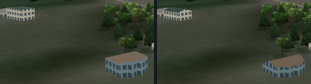
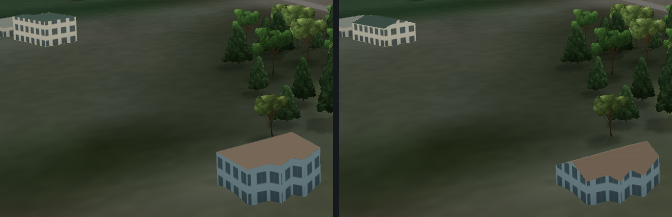

# East Point: two measured roof and wall-rim replacements in flight

Left: existing stock flat roofs. Right: the two roofs rebuilt from the
admitted 1 m height samples with the attached upper-wall changes.
These are unscaled, lossless crops from the same ordinary Chase frames
after the actual **East Point · lighthouse pass** launch in a private
test build. The changes are **not installed** in the public game.

**Approach at 254.021 m travel**

**Approach at 281.329 m travel**

| Travel from launch | Visibly changed RGB pixels (>2 code values) | Outside both isolated surfaces | Changed alpha |
| --- | ---: | ---: | ---: |
| 254.021 m | 2,553 | 0 | 0 |
| 281.329 m | 3,996 | 0 | 0 |
| 418.454 m, out of view | 0 | 0 | 0 |

The native test substituted the verified geometry at the original
one sorted draw. Each frame kept its other render submissions and
restored both stock and candidate immediately and exactly. It compared
actual GPU position bytes and preserved the same draw count: the two
replacements together add 78 triangles, not a draw. The later frame
was unchanged even though the parent tile still submitted.

The [full-frame receipt](native.json) records the private test, with
PNG and linked shader hashes but not the original uncropped frames.
The two binary-channel scope images are [first](0-scope.png) and
[second](1-scope.png); red and green identify the respective owner
roles, not survey colours. Run `python crops.py` from this directory
with Pillow to reproduce the published crop counts. The source-fit
limits and exact original footprint custody remain in the [rim
study](../README.md). This is not a live release, a survey of the
foundations, or a visual grade for the rest of East Point.
