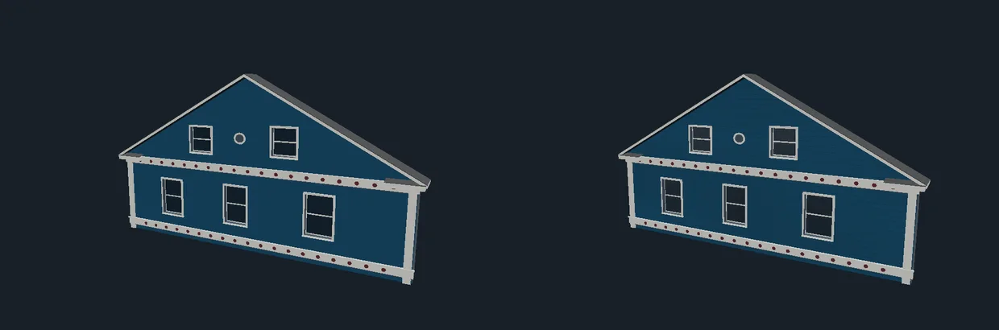

# Georgetown Historic Inn | Kent Street gable

**Detached Three.js exterior study. Not installed in the flight build.** The model depicts the observed upper gable and second-floor face: two pitched roof planes, blue timber siding, white eave returns, a coloured frieze, five true recessed sash groups and an original unlettered attic detail. The open questions below the visible section are deliberately not drawn. The matte backing, cut edges and local dimensions belong to the display, not to a surveyed building.



The [Kent Street lower frontage study](KENT-LOWER-STUDY.md) now adds the dated street-level openings to a separate detached copy. World placement remains on hold.

## Evidence

- The [Canadian Register of Historic Places entry](https://www.historicplaces.ca/en/rep-reg/place-lieu.aspx?id=1662) identifies the inn. Its Kent-side photograph, credited to C. Stewart / Province of Prince Edward Island, shows the gable, eave returns, trim and siding. The [operator’s gallery](https://georgetownhistoricinn.com/the-inn/) and [Tourism PEI listing](https://www.tourismpei.com/where-to-stay/georgetown-inn-restaurant) corroborate the broad palette.
- An [exterior photo published with an August 18, 2026 traveller review](https://www.tripadvisor.ca/LocationPhotoDirectLink-g635959-d628788-i876583543-The_Georgetown_Inn_Restaurant-Georgetown_Prince_Edward_Island.html) shows the upper openings and gable against the neighbouring veranda. The exact capture date, lower façade and adjoining roof extents are not established.
- Provincial footprint 109705 overlaps about 75% of the original building outline, `q11220/182`, on the correct parcel. That identifies the intended stock owner, but it does not establish that the outlines, additions or building elevations are interchangeable. No source pictures, brand lettering, or photo-derived textures appear in the model.

## Rendering and checks

The seven draw roles use real surface depth and opaque recesses. Optional original blue lap and roof finishes use metric UVs, filtered grooves and restrained grain. The pane reflection is analytic, not a view of the surroundings or an interior. The geometry stays identical when those finishes are switched off. [Matched software render checks](kent-gable-render-receipt.json) verify four viewpoints without a change to alpha or pixels beyond the intended visible surfaces.

```sh
node --experimental-strip-types --test tools/art/georgetown-inn-kent-gable/*.test.mjs
```

## Placement hold

The current flight build shows the inn as a flat, four-storey block. Painting that block blue leaves its most conspicuous error intact. The 2020 survey supports a pitched portion, but one flank failed the reserved one-metre-cell test (0.97 m 90th-percentile error against a 0.85 m limit). A separate check using disjoint raw survey returns likewise failed at least one threshold on each flank. These are two samples of the same historical survey, not evidence of a current complete roof. The measured areas also cannot close the lower façades and joins. Neither the stock building nor its ground, collision or flight path is changed here.
