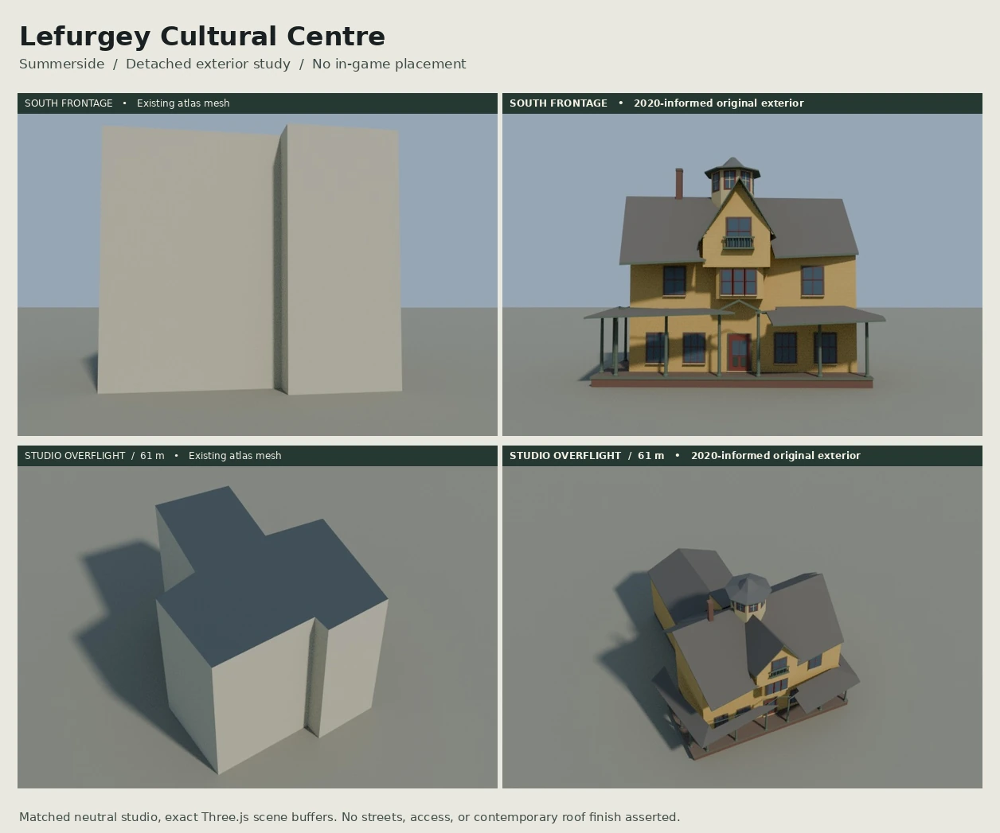

# Lefurgey Cultural Centre exterior study

**Detached authoring only. Production placement is on hold.**

The existing atlas uses a tall flat block for this Summerside landmark. This
editable Three.js study gives it back its steep gables, lower wing, wrapped
veranda and octagonal cupola. Wall profiles, paint, window details and the
entrance pediment are original interpretations, not an as-built survey.



## Edit or export

From the repository root with its dependencies installed (Node.js 22.12+):

```sh
node --experimental-strip-types tools/art/lefurgey-study/qa/verify.mjs
node --experimental-strip-types tools/art/lefurgey-study/studio.mjs --out lefurgey-study.glb
```

Open the GLB in Blender or another glTF editor. Edit the model in
[`lefurgey-study.ts`](src/lefurgey-study.ts); the roof logic and fitted input
coefficients sit beside it. Export preserves the mesh and base materials, not
the neutral studio lighting or procedural studio shading in the images.
The game does not import this tool. No geographic placement or network requests.

## Evidence and limits

- **2020 measured heights:** [NRCan CanElevation Point Clouds](https://open.canada.ca/data/en/dataset/7069387e-9986-4297-9f55-0288e9676947),
  PEI project, CGVD2013. Contains information licensed under the
  Open Government Licence – Canada.
- **Appearance references:** The [Canadian Register](https://www.historicplaces.ca/en/rep-reg/place-lieu.aspx?id=4102),
  [Culture Summerside](https://www.culturesummerside.com/lefurgey-cultural-centre)
  and the [2024 PEI Arts & Heritage Guide](https://artsandheritagepei.ca/wp-content/uploads/2024/05/Arts-Heritage-Guide-2024-EN.pdf)
  establish the distinctive exterior features. The [City’s 2025 roof replacement RFP](https://www.summerside.ca/UserFiles/Servers/Server_19514871/File/Building%20%26%20Development/Tenders%20%26%20RFP%27s/2025/RFP%20Lefurgey%20Roof%20Replacement%202025%20KM.pdf)
  was a reference, not evidence of completion or current
  shingle material. No reference photographs or drawings are distributed.
- **Why the model stays out of the game:** A same-survey replay of 898 training
  returns reduces p90 roof error from 9.96 m to 0.205 m, but unresolved joins
  still miss some returns by up to 6.87 m. The independent reserve was not
  scored. No current roof finish, exterior access, or grounds are asserted.

[Compact reproducibility receipt](proof/reproducibility.json)
