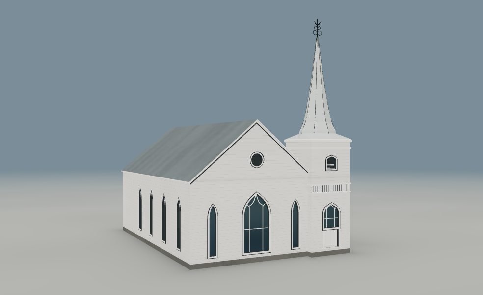
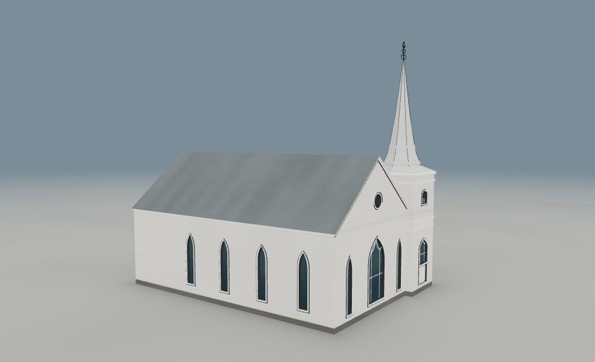
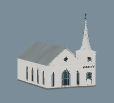

# New Glasgow Christian Church: detached exterior study

An original Three.js reconstruction of the front and photographed flank of the church as seen in February 2012. The offset tower and swept spire, iron thistle, recessed pointed triplet, four flank lights, slatted tower frieze and layered gable trim are geometric, rather than markings applied to the existing flat block. Rear faces are undecorated closure, not a reconstruction of hidden architecture.







## What the sources support

- [Carter W. Jeffery, *New Glasgow – a winter wonderland today*, February 18, 2012](https://peiheritagebuildings.blogspot.com/2012/02/new-glasgow-winter-wonderland-today.html) photographed the frontage and one flank in one oblique and the iron thistle separately. The open pages are observation references only; no rights for texture redistribution are assumed. There are no photograph pixels, copied signs, or external art textures in this package.
- [New Glasgow Christian Church's address](https://ngcc.ca/visit/) and [the congregation's documented history](https://ngcc.ca/ourroots/) corroborate the identity and historical architectural cues. They do not independently calibrate the 2012 photograph. Roof gray, artistic daylight, layout sizes, slat count, glazing response and weathering are interpreted. No current cladding material, height, footing, stairs or rear extension is claimed.
- The signed horizontal stock owner is `q03310/90`. The stock plan sits almost entirely within the associated provincial polygon `60860`, but its old/new intersection-over-union is only 0.6182; that is not authority for a whole-building replacement. Map acquisition dates and extension chronology aren't inferred. See [source custody](SOURCES.json).
- The 1× crop is an isolated 80 × 77 px subject, taken directly from an unscaled 984 × 600 render in a separate approximate northwest camera. The two main plates are full-resolution; their light, ground and framing are studio choices. They are not a native flight comparison. The existing River Clyde flight, default buildings, terrain, shadows, collisions and controls are unchanged.

## Use the detached mesh

On Three.js r187, add only the returned mesh to an isolated model scene. Its coordinates are local for display and it assumes a rigid or uniformly scaled parent. It has one opaque draw, no texture or fetch dependency, and 6,376 triangles. Nothing mounts automatically. The optional studio ground is separately owned, so omit it when inspecting the geometry alone.

```ts
import { makeChurchDetached } from './church-core.ts';

const study = makeChurchDetached();
scene.add(study.mesh);
// Renderer for the supplied plates: ACESFilmicToneMapping at exposure 1,
// SRGBColorSpace. Use the eye/aim values in CHURCH-VIEW-PRELOCK.json.
// When finished:
scene.remove(study.mesh);
study.dispose();
```

## Reproduce the checks

From this study directory with repository dependencies available (Node 24, Three.js r187), run:

```sh
node --experimental-strip-types --test church-core.test.mjs
node --experimental-strip-types render-packet.mjs | \
  PYTHONDONTWRITEBYTECODE=1 python3 studio-church.py fresh-local-output
```

The second command additionally needs Mesa EGL/GLES3, Pillow and NumPy, and rejects an existing output directory. It writes software EGL plates at actual four-sample RGBA8/D24 with the expanded r187 shader and archived camera matrices. Each unchanged studio frame was redrawn, read back and compared byte-for-byte. Browser flight, comparable built-game visibility, and surveyed placement are deliberately untested here.
