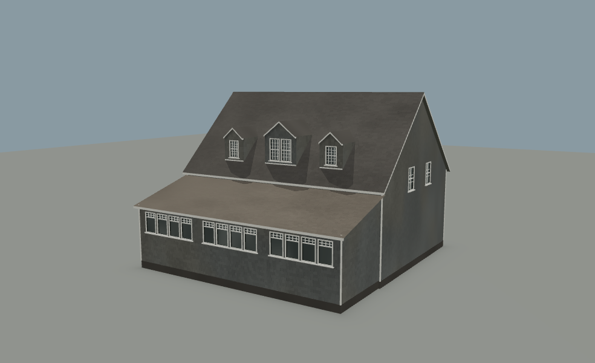

# The Mill in New Glasgow

A detached Three.js reconstruction of the river-facing exterior of the
[registered New Glasgow Mill](https://www.historicplaces.ca/en/rep-reg/place-lieu.aspx?id=24141&pid=0).
The main steep gable, three projecting dormers, recessed sash
windows, weathered shingle cladding, and lower glazed verandah are
original geometry and materials. The larger middle dormer has two
sashes; each side dormer has one. No aerial or donor-photo pixels,
brand graphics, staged aircraft, or surrounding assets are used.

The shape follows cues documented by the register and visible in the
[operator's daylight reference](https://themillinnewglasgow.com/wp-content/uploads/2025/09/hero-new.jpg)
and [separate dusk reference](https://themillinnewglasgow.com/wp-content/uploads/2020/07/opengraph.jpg).
Those dates identify their upload paths, not capture dates. The opposite
side and below-grade work are not reconstructed from these images. The
model is a visual interpretation, not a survey of modern materials,
foundation, current paint, window dimensions, or authorized building
placements.

## Site and stock flight

The original buildings atlas contains the Mill in q03310/7. The dated
Canadian AEB outline overlaps a separate published provincial footprint
by about 89.1% (intersection divided by union); this does not authorize
the difference between them. The stock engine model is a generic flat
cap. The two areas remain separately identified instead of borrowing
nearby roofs or other landmarks.

The private ordinary route flew on live scenery without forced time
or cameras. At +209.303 m and +365.815 m, only the selected original
building's diagnostic colour was visible (1,554 / 7,472 pixels).
The exact neighbouring geometry, background and alpha did not change
and stock was restored. The +971.783 m exit was fully behind the
camera with the original building draw intact and the stock
frames identical. These are separate original-scene comparisons,
not results from a new Mill mounted in flight.

A 2020 native 1 m elevation pair is available, but its registered
two-slope split did not have enough independent blocks across both
slopes. No height ordinates were opened and no measured roof or
foundation is fitted. The detached model does not replace the stock
scene, river, adjacent buildings, shore, ground, or flight controls.

In the unscaled [appearance study](stock-and-mill-at-scale.png), left is
the existing scene at the closer flight station. Right is the isolated
model at the same approximate apparent scale, on a neutral background.
It is not an in-game swap, surveyed placement, or result from a
full-scene replacement.

## Inspect the model locally

From the repository root, run `npm install` and `npm run dev`, then
open `/tools/art/new-glasgow-mill/index.html` on the local Vite server.
Choose the river elevation or oblique gable view for details. The
approach and flyover presets show the model at representative distances
without moving a real simulation camera.

Run `node --experimental-strip-types --test tools/art/new-glasgow-mill/mill-exterior.test.mjs`
for the modeled dormer joins, apertures, drawing data, and resource checks.
See the [source and scope record](evidence/source-and-scope.json)
and [original live flight score](evidence/stock-flight.json). Numerical
data sources are listed separately from the cited images. No source
photo, third-party texture, or terrain/movement change is included.

The [workbench browser check](evidence/workbench-browser.json) loaded
the isolated model in desktop and compact viewports and rendered all
four presets in each, without page errors or off-site requests. These
are controls and render checks, not hardware performance benchmarks.
