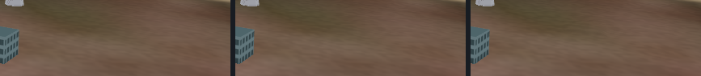
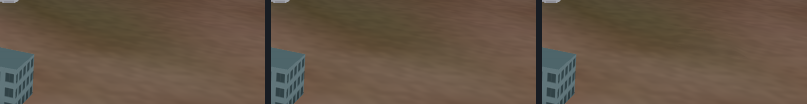

# North Cape: measured dry relief on the current flight route

Unscaled, lossless crops from two private visual comparisons on the
actual **North Cape · lighthouse low pass**. Left is the ordinary
terrain, middle is the same new triangulation kept on the ordinary
plane, right uses the measured heights. The published simulator still
uses the ordinary terrain.

**Approach, 287.973 m from launch**

**Closer view, 329.769 m from launch**

| Travel | Stock to neutral >2 RGB codes | Neutral to measured >2 RGB codes | Height effect outside the projected footprint |
| --- | ---: | ---: | ---: |
| 287.973 m | 0 | 386 | 0 |
| 329.769 m | 0 | 710 | 0 |
| 433.441 m, outside the camera | 0 | 0 | 0 |

The author variation changes only heights in the measured dry patch.
The accepted ground draw retained its original linked program, position,
UV and element inputs or their exact proposed counterparts. The active
terrain program does not consume vertex normals. The two same-topology
comparisons kept 144 other submissions unchanged; original draw count
and alpha were unchanged. Stock to neutral had 628 and 835 small RGB
differences, none larger than two codes. Stock restored exactly at
both positive checkpoints.

At the terminal checkpoint the original parent triangle and both new
streams were outside the same frustum plane by over 26 pixels after
accounting for Float32 arithmetic. The regular terrain tile still
submitted its draw. All four exit states were byte identical. An
earlier attempted exit at roughly 400 m was a hold with no saved raw
frame. In a different archived pose around 408 m, the raised interior
was outside but the whole neutral annulus was not. The current gate
requires the complete triangle, not just the changed vertices.

[Native frame receipt](native.json) includes the full image and bound
buffer hashes. Only the two lossless crops are distributed. Running
`python plates.py` with Pillow recomputes the delivered crop counts.
The original [source, geometry and exclusions](../README.md) remain
the authority for the detached packet. This subtle rendering effect
does not validate surface contact, material survey, device performance,
or live ground placement.
