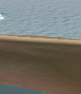
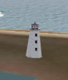
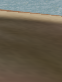
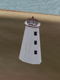

# North Cape lighthouse: matched ordinary-flight evidence

These are exact display-pixel crops from an isolated simulator candidate, not
exterior concept art or a feature enabled in the distributed game. The test
clicked the normal Begin flight control with the route ready, then let the
aircraft fly its ordinary Chase view. It sampled three points in order on the
same pass. No camera jumps, detached Studio image, or edited terrain basemap
are used for the crops.

| Same camera/frame | Stock | Candidate |
| --- | --- | --- |
| Approach, 287.966 m along the course |  |  |
| Near, 408.347 m along the course |  |  |

Coordinates are **travel from the start, not range to the tower**. At each
real frame, separate white/black substitutions mark only the passing solid
and lantern-glass fragments through the same ordinary depth; then both
the original and preview states are restored. Display RGB changes of 921
and 3,302 pixels respectively were completely inside those roles. All
other RGB and all alpha were exactly unchanged; both restored images were
exact. The regular ground was submitted once in all eight variants. The only
additional normal submissions at either positive were two authored draws
and 3,924 triangles. At 612.400 m the tower was genuinely off-screen and all
variants were byte-identical after RGBA decoding. This is not evidence for a
visible distance-tier transition.

Additional control sessions exercised Summerside, Cavendish, East Point and
the original North Cape wind-farm route. They compared the original 58
dispatch labels, normal spawn poses, flight progression and pause/camera
controls across stock and candidate. A separate positive control put the
new flag onto that original wind-farm route; it added only one Dispatch
choice and did not draw a lighthouse on that flight. This is behavior
coverage, not rendered-pixel equality for those four routes.

The art is still held from the distributed simulator. It is seated against
the simulator's stock visual terrain, not a surveyed foundation position,
angle, or elevation. The bare area immediately around the tower and absent
ground contact lighting are visible limitations. No current survey, Google
Maps, terrain, landscape tile, flight dynamics change, or new public
departure are included in this change.

## Audit

`private-pair-receipt.json` is the sealed phase aggregate
(SHA-256 `8e6afb5f0bc2b814e0393fb9cdbf4139089cdc1bbc717d9788a7125173dbbd69`).
The phase JSONs pin 24 raw captures and actual linked programs.
`pixel-replay.json` records the replayed counts and half-open original-pixel
crop bounds. The tiny retained crops are direct extractions without
resampling, grading, or sharpening.

Run `python recheck.py ORIGINAL_CAPTURE_DIRECTORY --crops NEW_DIRECTORY`
with Python 3.10+, Pillow and NumPy to rehash the original PNGs, rescore the
RGB scopes and rollbacks, and regenerate the retained crops. Full-screen
captures and linked shader copies are not bundled. The separate original
stock-control aggregate has SHA-256
`45bc925c9804b6b7b836ea52ccc2a99a3c5c40c24ec9bb9305626388bdfe462a`.
