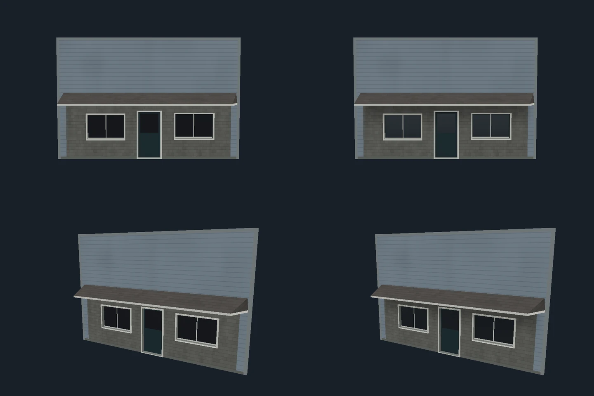

# Doiron Fisheries storefront | North Rustico

**Original Three.js art study. Not installed in the simulator.** It represents only the photographed entrance section, not the whole shop or its current condition. In each row below, the same model is shown without (left) and with (right) the optional glazing and local shading.



## Reference and scope

- The [market's gallery](https://www.peifishmarket.com/beautiful-north-rustico) shows the entrance in a photograph with an original capture timestamp of June 30, 2014. A second photograph hosted by the operator in 2022, with no verified capture date, corroborates the window–glazed door–window grouping and the continuous shingled hood. Other openings, painted lettering, signs and seasonal decorations are outside this study.
- The [operator](https://www.peifishmarket.com/) and [Tourism PEI](https://www.tourismpei.com/attractions/doiron-fisheries-ltd-fish-market) identify 56 Harbourview Drive. Two independently mapped outlines both intersect the same simulator building, `q03330/113`. The outlines, civic point and 2020 aerial context support the north-facing entrance attribution, not its exact position or width along that wall.
- Blue-grey horizontal siding, weathered lower shingles, pale window casings and the shallow hood are modelled from visual observations. There are no source photos, copied lettering, image textures, or scanned geometry in the model. The display extents, recess depth and hood projection are original approximations, not measured dimensions. The matte perimeter marks the cut edge of the study, not property trim.

The windows and door have real recesses and opaque backstops. The hood has a closed top and underside. Optional optical stages add a direction-dependent procedural reflection to the panes, shading below the hood, and a small darkening around the three openings. These are bounded effects in the detached model, not a reflection of the simulated sky or a full shadow calculation.

## Review

```sh
node --experimental-strip-types --test tools/art/north-rustico-doiron-storefront/*.test.mjs
```

The tests check exact geometry and neutral cut boundaries, opening and hood ray hits, shader scope, disabled optics and geometry parity. The [software raster receipt](entry-optics-render-receipt.json) covers four viewpoints and four independent effect settings. It records zero changed pixels outside their allowed visible surfaces and exact off-state restoration. These renders are not a browser or GPU performance result.

## Why it is not in the flight build

The photographic references do not locate the complete entrance precisely along the simulator wall. The protected 2020 elevation comparison also rejected the candidate roof on one wing (90th-percentile error 0.77 m against a 0.65 m limit). Shipping the entrance with an unverified placement or passing it off as a complete building would obscure those gaps. This commit does not move the stock building, ground, shore, collision, or flight route.
