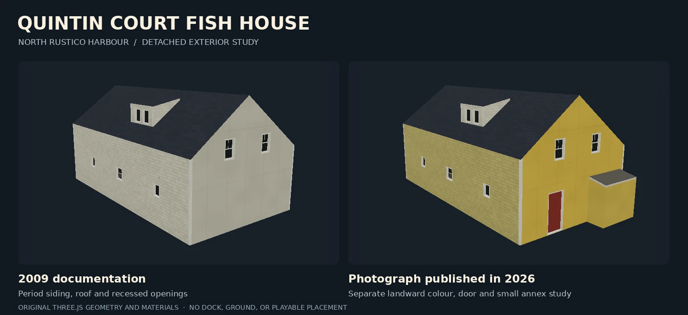

# Quintin Court Fish House | North Rustico

**Detached Three.js art study. Not enabled in the simulator.** This folder keeps the roof study, the 2009 exterior interpretation, and a separate comparison of details visible in a photograph published in September 2026. None changes the map, collision, scenery downloads, or default flight.



## What is grounded in the sources

- The [Canadian Register of Historic Places](https://www.historicplaces.ca/en/rep-reg/place-lieu.aspx?id=20879&pid=0) identifies the building and documents the gable, wood shingles, openings, 2003 remodel, and timber support. Its three 2009 elevation photographs, credited to F. Pound / Province of Prince Edward Island, guided proportions and the window roles. Their images and lettering are not used in the game or the study.
- Provincial footprint 57964 and parcel 434563 identify the single stock building at `q03330/633`. The provincial polygon overlaps about 89% of the original outline; it is not proof of the exact current walls or annex perimeter. The authored hull starts from the original plan.
- The direct [2020 PEI elevation survey](https://open.canada.ca/data/en/dataset/0fe65119-e96e-4a57-8bfe-9d9245fba06b) supports a shallower main gable than the stock shape. The frozen 34-cell training fit is 36.78 degrees. Independent coverage was too sparse to certify both flanks, absolute height, eaves, dormer or roof closures. The study uses only the fitted local slopes; display floor zero is not a geographic elevation.
- A [photograph published in September 2026](https://arenglishtravels.blogspot.com/2026/09/pei-2026-north-rustico-home-swap.html) shows a yellow landward gable, worn pale side, red lower door, and one small landward addition. The optional artistic comparison follows only those visible details. Its restrained colour, door dimensions and compact annex are original approximations. The waterfront façade, survival of the old balcony, and exact capture date are not verified.

## Art and validation

The 2009 comparison uses recessed opaque sashes, front winding, metric UVs and filtered original procedural shingles. The later appearance leaves the original roof and underside intact. It can opt into the palette, landward door, and bounded annex separately. There is no source-photo texture, borrowed lettering, or auto-placement.

Run the CPU checks with the repository's pinned Three.js:

```sh
node --experimental-strip-types --test tools/art/north-rustico-fish-house-study/*.test.mjs
```

## Why it stays detached

The old simulator's carrier is dry at the building. Two dated visual angles show open water or tidal mud below the deck, and the publicly available hydrographic grid cannot resolve the small footprint. The surveyed height of the platform, exact pile positions, land/water boundary, and terrain contact remain unverified. Neither study depicts the deck, foundations, or site as a certified current structure. Only the in-game stock building is rendered at that location.
