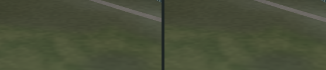

# Panmure Head: actual Chase result, not enabled

The compact terrain is visible from the real Panmure Head departure, but
it is too subtle at one of the required approach viewpoints to release.
This is a checked prototype, not an installed preview. Nothing changes
on the public route, and collision still uses the original ground.

Tests used the stock route and controls on a sealed private build
based on `2827225`, with 4× antialiasing at 1200 × 760. The tester
pressed the ordinary Begin button and left the aircraft in its real
Chase camera. On each selected frame, the existing sorted ground draw
used stock, then neutral tessellation, then the raised packet, then
stock again. The variant drew 450 more triangles in the same call.
Draw scope was independently reconstructed from the **actual uploaded
position buffers, index buffers and camera matrices**, not an offline
render posed nearby.

| Flight distance | Stock to raised pixels >2 RGB codes | Neutral to raised >2 | Result |
| --- | ---: | ---: | --- |
| 560.512 m (approach) | 0 | 0 | Below the required 64 in both comparisons |
| 682.322 m (near) | 184 | 187 | Both visible signals pass |
| 1031.681 m (exit) | 0 | 0 | The affected cell is fully clipped and all four frames are equal |

No pixel changed outside the projected geometry guard. Alpha and each
full restored image were exact. The original draw was still present at
the exit: the candidate is out of the aperture, not hidden by stopping
streaming. The browser's ordinary tile had additional outer-edge
stitching heights; those original uploaded bytes were left in place,
not substituted by the offline terrain archive. The checked crop
does not identify a separate sky, road or vegetation material by shader.



[Frame digests and original acceptance scores](native-flight-receipt.json).
This is close to the minimum for visibility under the existing lighting,
not a new grass texture or sign of province-wide coverage. The closer
positive does not override the earlier miss.

## Why not simply widen the mesh at the same edge?

For the larger parent's 13 interior edge segments, an
[exact feasibility check](interior-edge-screen.json) enumerates every
interior position on the original GPU Float32 X/Z grid. Many cardinal
edges have more than 13,000 candidates, while the five diagonal edges
have none. **None of the 13 edges** has an interior candidate that also
preserves the exact neutral X/Y/Z and the inherited UV and normal
channels in both coordinate bases. An exact single-cell perimeter still
works because it borrows original endpoints. This does not assert that
a separately bounded approximation with native controls is impossible.

The edge check takes the output of [the stock replay](../README.md).
Run with Python/NumPy:

```sh
python3 tools/art/panmure-dry-grade/compact/native-flight/check-interior-edges.py \
  --stock "$scratch/stock" --out "$scratch/edge-screen.json"
```
