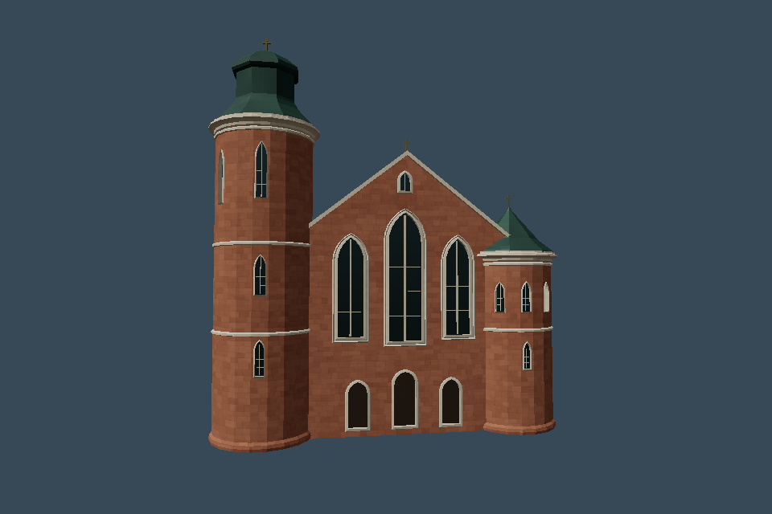

# St. Mary’s, Souris · exterior workshop

This original Three.js study models the unequal towers, green copper caps, sandstone façade and Gothic lancets of St. Mary’s Roman Catholic Church, 1 Longworth Street, Souris. **It is not fitted to terrain or installed in the live simulator.** The dimensions are approximate studio proportions, not a survey or measurements of the present-day church.



[Oblique studio angle](proof/studio-oblique-lancets.webp) · [Sandstone finish comparison](proof/stone-v2-native.json)

## Open the studio

From the project root, install dependencies with `npm ci`, run `npm run dev`, and open `/tools/art/souris-st-mary-study/` on the local URL Vite prints. The viewer has four camera presets, orbit controls and a switch that compares procedural finishes with the same plain-colour mesh. The Chase viewing angle approximates a real approach bearing, not its distance or surrounding scenery. The studio makes no external texture requests and is not included in the flight build.

## Evidence and limits

| Evidence | What it supports |
| --- | --- |
| [Historic Places register, record 19171](https://www.historicplaces.ca/en/rep-reg/place-lieu.aspx?id=19171), [parish exterior](https://www.mcmcpei.com/st-marys) and [Quintin Soloviev’s December 2024 exterior photograph](https://commons.wikimedia.org/wiki/File:St._Mary%27s_Roman_Catholic_Church,_Souris_PEI.jpg) | Two unequal round end towers, the taller polygonal copper cap, the simpler lower cap, pale stone reveals and dark lancets in sandstone. The model does not transfer pixels, textures or traced source geometry. |
| [Stock owner and public registration](longworth-horizontal-receipt.json) | The Souris renderer’s building q130333/114 maps to the exact church parcel. The stock renderer draws a single flat cap with 21 coplanar roof triangles. The civic pin marks the frontage, not the centre of the church. |
| [Exact geometry and ray results](st-marys-detached-exact-buffers.json) | Seven opaque material groups and 4,730 base triangles, exact repeated buffers, analytic roof area hits and physically recessed front openings. |
| [Matched native software-rendering checks](proof/native-receipt.json) and [ordinary poses](proof/ordinary-cameras.json) | The same sixteenth-second Chase camera sees a changed silhouette in an isolated comparison. The 18th- and 20th-second matrices do not place the exterior on screen. The clearer studio views do not replace those negatives. No live replay or hardware performance claim. |

The studio's approximate heights and alignment are unsuitable for removing stock geometry. The taller tower’s independently mapped roof region falls outside the old footprint. Foundations, old-wall replacement, terrain contact and protected adjacent assets are unresolved. Raw LiDAR heights were not used to fit this study. A separate check of 69 registered one-metre cells from the [named 2020 PEI surface and bare-earth grids](https://open.canada.ca/data/dataset/957782bf-847c-4644-a757-e383c0057995) passed none of the seven predeclared relative height checks. This rejects the studio model as a placement candidate. It does not establish the heights of the real towers or disprove the visible silhouette. The studio’s irregular sandstone pattern changes only the stone material: the linked native review found no changed pixels outside the stone support and exact restoration of the previous finish.

## Three dressed lancets

The three tall windows above the southwest doors have a second raised freestone shoulder, visible in the heritage elevation and the December 2024 photograph. The studio draws 156 new triangles in the existing freestone group, for 4,886 triangles over the same seven groups. All prior vertex data, visible glass depth, openings, silhouette and roof remain unchanged. In the [fixed native comparisons](proof/lancet-native.json), 2,804 close entry pixels cross the two-code RGB difference threshold, compared with just 36 in the sixteenth-second Chase camera. There is no change in the two off-screen poses. These frames show an original sculpted detail, not dimensioned stonework, a live scenery change or a flight-visible improvement.

[Older entry render without the second shoulder](proof/studio-entry.webp) · [Exact Three.js geometry and aperture tests](proof/lancet-geometry.json)

## Verification

```sh
node --experimental-strip-types tools/art/souris-st-mary-study/souris-st-mary-test.mjs
node --experimental-strip-types tools/art/souris-st-mary-study/lancets/check-lancet-geometry.mjs
./node_modules/.bin/tsc -p tools/art/souris-st-mary-study/tsconfig.json
```

The development workflow also opens the studio in Chromium, checks the material toggle, switches viewpoints and checks a mobile viewport. The flight simulator uses its existing compiled build for its separate browser checks.

**Attribution:** The registration uses Natural Resources Canada’s [Automatically Extracted Buildings](https://open.canada.ca/data/en/dataset/7a5cda52-c7df-427f-9ced-26f19a8a64d6) under the [Open Government Licence – Canada](https://open.canada.ca/en/open-government-licence-canada), provincial spatial data from GeoLinc under the [Open Government Licence – Prince Edward Island](https://www.princeedwardisland.ca/en/information/finance/open-government-licence-prince-edward-island), and the [© OpenStreetMap contributors](https://www.openstreetmap.org/way/1088035096) reference outline under the [ODbL](https://www.openstreetmap.org/copyright). No raw survey returns or reference images are included. The model’s proportions, stonework, metal and glass are original artwork.
