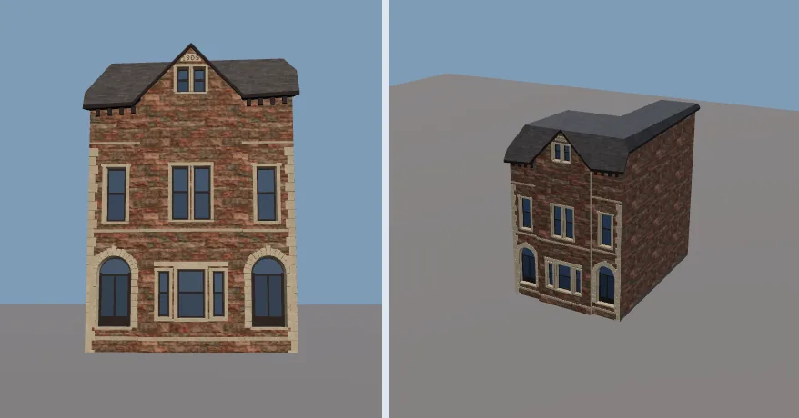

# Souris Town Hall: exterior source study

An original, metre-scale Three.js and TypeScript asset of the Main Street
frontage at 75 Main Street, Souris. This is a **detached authoring asset**.
The flight simulator still shows the existing atlas building at this
location. The tool does not change a streamed mesh, placement, shadows,
collision or any live choice.



The façade reproduces the observed arrangement: separate arched left and
right openings with carved stonework, a three-part lower sash, four
second-tier sashes and the paired upper sash below the 1905 stone. The
model has real backed recesses, its own irregular sandstone and buff
freestone finish, a stepped front bay and bracketed eaves. It uses no
photograph pixels, building textures or extracted street imagery.
A visible doorway is not an accessibility or entrance claim.

## Reference and scale

- [Canadian Register of Historic Places](https://www.historicplaces.ca/en/rep-reg/place-lieu.aspx?id=18705):
  identification, exterior arrangement, sandstone and lighter freestone.
- [Quintin Soloviev's August 2026 photograph](https://commons.wikimedia.org/w/index.php?title=File:Souris_Town_Hall_(PEI).jpg&oldid=1269776363)
  ([CC BY 4.0](https://creativecommons.org/licenses/by/4.0/)) and
  [the provincial library photograph](https://www.princeedwardisland.ca/en/point-interest/souris-public-library):
  count and proportions of visible street-facing features. The photos
  support design observation only and are not included or remapped.
- [1905 construction account, transcribed from the Daily Examiner](https://www.islandregister.com/1800snewpo.html)
  and [2011 repair notice](https://archivenews.princeedwardisland.ca/governments-celebrate-completion-retrofit-olearys-community-complex-and-upgrades-souris-town-hall):
  the older account supports a shingled roof with an upper flat area,
  but does not supersede the later rehabilitation, visible frontage or
  LiDAR. The roof material here is an optical approximation.
- [NRCan Automatically Extracted Buildings](https://open.canada.ca/data/en/dataset/7a5cda52-c7df-427f-9ced-26f19a8a64d6),
  pinned atlas `q130331/72`, [NRCan CanElevation point clouds](https://open.canada.ca/data/en/dataset/7069387e-9986-4297-9f55-0288e9676947) and [NRCan PEI 2020 HRDEM](https://datacube.services.geo.ca/pgstac/api/collections/hrdem-lidar/items/PEI-Prince_Edward_Island_2020-1m):
  the ordered footprint, the original 2020 Class 6 returns from the named survey, and the registered 1 m height grids. The local tangent frame
  matches the simulator: frontage is about 9.04 m in this frame; it is
  about 9.17 m measured in the EPSG:3979 source projection.
  Contains information under the [Open Government Licence – Canada](https://open.canada.ca/en/open-government-licence-canada).

## What is verified, and what is not

The table compares actual Three.js rays at 95 spatially held-out medians
of original non-withheld Class 6 returns, reduced to 0.40 m local cells.
These 14 held 1.37 m blocks are separate from the fitting and ranking
blocks in the same 2020 survey. They qualify only the main roof surfaces,
not every local roof detail.

| Roof evaluated on that restricted sample | Absolute p90 error |
| --- | ---: |
| Current flat atlas cap | 3.894 m |
| Fitted main roof without the photo-informed front gable | 0.126 m |
| Fitted main roof with the photo-informed front gable | 0.142 m |

The source has a higher compact east feature and a lower west/rear
surface that this asset does **not** reproduce. Original 2020 Class 6
returns show both features; the high feature fits the current flat cap
better than this particular staged variant. The blank side and rear
appearance is unverified. The two stair runs are not modelled or seated
here. Those gaps block placing the asset in the live map; the useful
front is not certification of the whole building.

The [three-dimensional geometry checks](qa/actual-three.ts) evaluate the
actual typed mesh: mutually exclusive roof coverage in the modelled
plan and backed aperture rays from three exterior directions. The
packaged [browser measurements](proof/three-browser.json)
come from the preview tied to this exact source. The isolated preview
builds original demonstration textures synchronously; a production
loader still needs a bounded asset or asynchronous bake and appropriate
failure behaviour. No GPU speed or frame-rate promise follows from
the fixture.

## Work on the asset

From the repository root with its locked npm dependencies already installed:

```sh
node_modules/.bin/tsc -p tools/art/souris-town-hall-study/tsconfig.json
node --experimental-strip-types tools/art/souris-town-hall-study/qa/actual-three.ts
node_modules/.bin/vite tools/art/souris-town-hall-study --host 127.0.0.1
```

Append `?shot=air`, `?shot=west` or `?shot=detail` for review views.
Add `light=sim` to use the current simulator sun direction in the
local frame. This viewer uses the existing CC0 sky probe and a plain
review floor, not the playable environment or the surrounding town.
