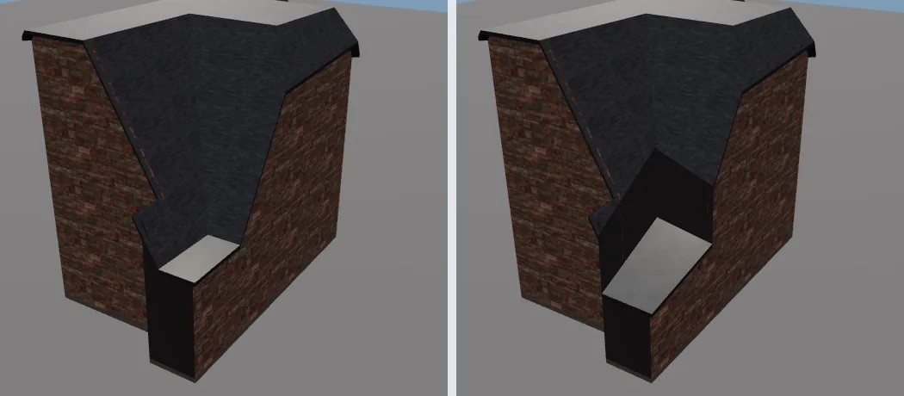
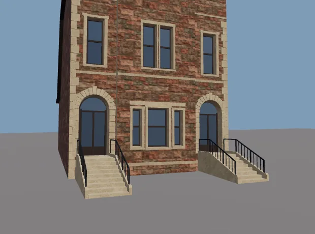
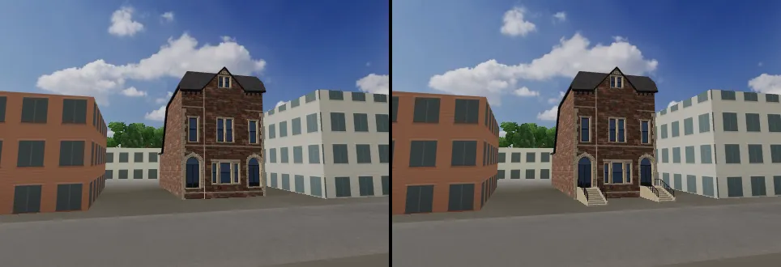
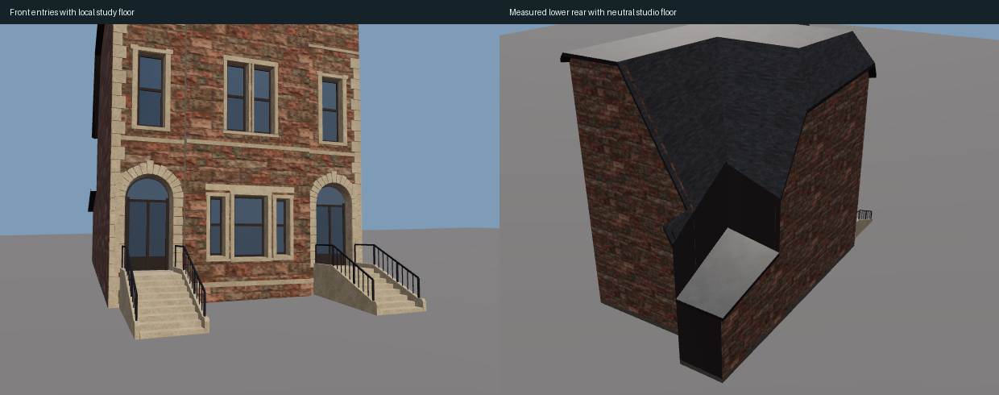

# Souris Town Hall: exterior source study

An original, metre-scale Three.js and TypeScript asset of the Main Street
frontage at 75 Main Street, Souris. This is a **detached authoring asset**.
The flight simulator still shows the existing atlas building at this
location. The tool does not change a streamed mesh, placement, shadows,
collision or any live choice.


The façade reproduces the observed arrangement: separate arched left and
right openings with carved stonework, a three-part lower sash, four
second-tier sashes and the paired upper sash below the 1905 stone. The
model has real backed recesses, its own irregular sandstone and buff
freestone finish, a stepped front bay and bracketed eaves. It uses no
photograph pixels, building textures or extracted street imagery.
A visible doorway is not an accessibility or entrance claim.

## Reference and scale

- [Canadian Register of Historic Places](https://www.historicplaces.ca/en/rep-reg/place-lieu.aspx?id=18705):
  identification, exterior arrangement, sandstone and lighter freestone.
- [Quintin Soloviev's August 2026 photograph](https://commons.wikimedia.org/w/index.php?title=File:Souris_Town_Hall_(PEI).jpg&oldid=1269776363)
  ([CC BY 4.0](https://creativecommons.org/licenses/by/4.0/)) and
  [the provincial library photograph](https://www.princeedwardisland.ca/en/point-interest/souris-public-library):
  count and proportions of visible street-facing features. The photos
  support design observation only and are not included or remapped.
- [1905 construction account, transcribed from the Daily Examiner](https://www.islandregister.com/1800snewpo.html)
  and [2011 repair notice](https://archivenews.princeedwardisland.ca/governments-celebrate-completion-retrofit-olearys-community-complex-and-upgrades-souris-town-hall):
  the older account supports a shingled roof with an upper flat area,
  but does not supersede the later rehabilitation, visible frontage or
  LiDAR. The roof material here is an optical approximation.
- [NRCan Automatically Extracted Buildings](https://open.canada.ca/data/en/dataset/7a5cda52-c7df-427f-9ced-26f19a8a64d6),
  pinned atlas `q130331/72`, [NRCan CanElevation point clouds](https://open.canada.ca/data/en/dataset/7069387e-9986-4297-9f55-0288e9676947) and [NRCan PEI 2020 HRDEM](https://datacube.services.geo.ca/pgstac/api/collections/hrdem-lidar/items/PEI-Prince_Edward_Island_2020-1m):
  the ordered footprint, the original 2020 Class 6 returns from the named survey, and the registered 1 m height grids. The local tangent frame
  matches the simulator: frontage is about 9.04 m in this frame; it is
  about 9.17 m measured in the EPSG:3979 source projection.
  Contains information under the [Open Government Licence – Canada](https://open.canada.ca/en/open-government-licence-canada).

## What is verified, and what is not

The table compares actual Three.js rays at 95 spatially held-out medians
of original non-withheld Class 6 returns, reduced to 0.40 m local cells.
These 14 held 1.37 m blocks are separate from the fitting and ranking
blocks in the same 2020 survey. They qualify only the main roof surfaces,
not every local roof detail.

| Roof evaluated on that restricted sample | Absolute p90 error |
| --- | ---: |
| Current flat atlas cap | 3.894 m |
| Fitted main roof without the photo-informed front gable | 0.126 m |
| Fitted main roof with the photo-informed front gable | 0.142 m |

The source has a higher compact east feature and a lower west/rear
surface that this asset does **not** reproduce by default. Original 2020
Class 6 returns show both features; the high feature fits the current flat cap
better than this particular staged variant. The blank side and rear
appearance is unverified. The two stair runs are not modelled or seated
here. Those gaps block placing the asset in the live map; the useful
front is not certification of the whole building.

The [three-dimensional geometry checks](qa/actual-three.ts) evaluate the
actual typed mesh: mutually exclusive roof coverage in the modelled
plan and backed aperture rays from three exterior directions. The original paired [browser measurements](proof/three-browser.json)
record the synchronous authoring baseline tied to this exact model. The
viewer now paints the same model in matte first, then prepares and
transfers the procedural textures in a local module worker. It installs
all four material roles together or keeps the matte version if the
reply is malformed, blocked or times out. Unloading the page releases
the local worker and textures; the fixture is not the game's loader.

## Optional lower-rear evidence view

Use `?shot=rear&roof=lower-rear` in the authoring viewer. The selected
view lowers only a 12.45 m² core inside the same rear footprint, where
one 2020 LiDAR swath supports a separate roof plane. The other end of the
roof and the street-facing apertures remain unchanged. The right image
shows the selected lower plane and its modelled closure; the left shows
the original authoring envelope.



On 20 individual held-out Class 6 returns from four separate source blocks in this core,
absolute p90 drops from 2.390 m to 0.156 m. The same plane uses one
continuous texture coordinate system. The [mesh check](proof/rear-roof-geometry.json)
records 390 oblique closure rays with no misses and exact old geometry
array hashes when the option is off. The [compiled browser comparison](proof/rear-roof-browser.json)
keeps the street frame unchanged even with the option selected. An
unknown option preserves the default.

The vertical transition is an authored closure, not surveyed rear
joinery or verified siding. Upper-east returns overlap the main deck
in plan; the shape, hidden rear and both stairs remain unresolved here.
This is a measured local test, not live placement or a full exterior.

## Optional entrance study

Use `?shot=entry&entry=steps` in the authoring viewer. It adds two
original stone stair flights and paired railings at the observed
entrances. The choice is separate from the lower-rear evidence view;
when both are requested, the rear study takes precedence.

The arrangement follows the 2026 reference and [C C Gosselin's
July 2018 exterior photograph](https://www.flickr.com/photos/51856044@N00/29014219037/).
The latter is a visual reference only. Neither photo is bundled or used
as a texture. The observed rises differ: nine on the west and eight on
the east. The heights and landings model that visible order seated
against a registered portion of the game's terrain, not measured
construction drawings. There is no model of the centre terrace,
passage through the doors, ramp or actual accessibility.



The ground patch in this viewer is clipped from the actual near mesh of
terrain tile 27-14 and only supplements the detachable review floor.
It does not alter the game's heightfield. The [replayable ray test](qa/actual-steps.ts) checks 288 registered floor
probes plus the treads, embedded lower side faces, rails and nominal threshold; the
existing body and original roof attributes remain unchanged. The
[context replay](proof/entrance-context.json) is a comparison in a
test-only simulator build of the same building before and after adding stairs,
not evidence that the map ships this asset.



## Review both studies together

The separate combined viewer shows the two existing entrance stair studies
and the measured 12.45 m² lower-rear roof in their original metre frame.
It adds no surfaces, source imagery, textures or live simulator asset.
The entry angle uses the original local study floor; the rear angle uses
a neutral studio floor. Neither is evidence of whole-building placement.
The upper-east roof feature and actual rear enclosure remain unresolved.

Run from the repository root:

```sh
node_modules/.bin/vite --config tools/art/souris-town-hall-study/combined-vite.config.ts --host 127.0.0.1
```

Open `/combined-preview.html?study=lower-rear-and-steps` on that local
server and switch between **Front entries** and **Lower rear**. The
standard studio viewer and its previous URLs remain separate.



The [geometry receipt](proof/combined-geometry.json) replays the two
unchanged mesh assemblies. In the [native render check](proof/combined-preview-native.json),
each of the four existing viewer choices produced the same canvas
before and after the separate viewer was added. Each study surface group
matched its original standalone view at all tested interior points.
Both texture sizes and the blocked-worker matte fallback were exercised.

The [separate controls test](proof/combined-preview-fit.json) verifies
that the new top rail doesn't cover the stage. At 620 × 460 the two
art canvases remained pixel-identical. At a 360 px browser width, the
unstretched viewport retained all front stair and rear roof witness
points. The test also switched angles both ways with the keyboard.

[Full entry viewer](proof/combined-entry-control-rail.webp) ·
[Full rear viewer](proof/combined-rear-control-rail.webp)

## Work on the asset

From the repository root with its locked npm dependencies already installed:

```sh
node_modules/.bin/tsc -p tools/art/souris-town-hall-study/tsconfig.json
node --experimental-strip-types tools/art/souris-town-hall-study/qa/actual-three.ts
node --experimental-strip-types tools/art/souris-town-hall-study/qa/actual-rear.ts
node --experimental-strip-types tools/art/souris-town-hall-study/qa/actual-steps.ts
node_modules/.bin/vite tools/art/souris-town-hall-study --host 127.0.0.1
```

Append `?shot=air`, `?shot=west` or `?shot=detail` for review views.
Add `light=sim` to use the current simulator sun direction in the
local frame. With no texture option, the source study uses 512-pixel
plates. Add `texture=flight` for a 256-pixel authoring comparison, which
uses **2 MiB of raw RGBA data instead of 8 MiB** for the same eight
textures. Both choices match their synchronous recipe pixel-for-pixel in
the three [compiled browser checks](proof/deferred-textures-browser.json).
The lower tier is not an exact downsample of the higher one and
deliberately does not replace the close reference view automatically.
These allocation numbers omit mipmaps and do not measure device memory,
loading time or frame rate. The viewer uses the existing CC0 sky and a
plain review floor, not the playable environment or surrounding town.
