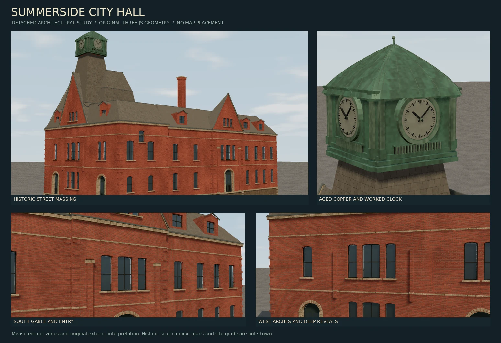

# Summerside City Hall exterior study

Three.js and TypeScript studio for the clock, roof and masonry of the
former Summerside Post Office. This folder is **not part of the playable
map**. It contains original geometry and materials, not reference photos.



Use Node.js 22.12 or newer:

```sh
npm ci
npm run build
npx vite preview --host 127.0.0.1
```

Open the preview address printed in the terminal. Try `?pose=clock`,
`?pose=street`, `?pose=southBay`, or `?pose=roof`. Add `&overcast`
for the alternate lighting comparison.

[Sources, held survey checks, and reuse limits](sources-and-review.md) ·
[Matched early/final views](proof/summerside-cityhall-A-to-E2.webp) ·
[Actual mesh-ray receipt](proof/roof-rays.json)
