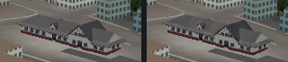
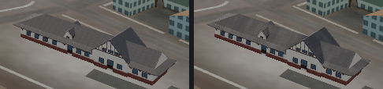

# Summerside roof in two ordinary Chase frames

Stock roof on the left, experimental lapped finish on the right. These
are native-size crops of normal **Summerside waterfront · low pass**
frames in a private browser build. The aircraft flew normally after the
actual **Begin flight** click; each pair changed only the roof material
at the original sorted draw, not the camera or simulation. The finish is now also available in a separate [optional Chase preview](../../../../../../docs/qa/summerside-rail-roof-preview.md). Standard remains unchanged.

**Approach**



**Closer view**



| Travel since launch | Roof pixels marked | RGB code delta greater than 3 | RGB changes off roof | Changed alpha |
| --- | ---: | ---: | ---: | ---: |
| 600.981 m | 1,700 | 932 | 0 | 0 |
| 701.980 m | 5,375 | 3,244 | 0 | 0 |

The whole-frame test verified identical stock, neutral and restored
frames and identical candidate/restored frames. The original 804 indices matched exactly. The native position, normal, UV and colour buffers kept the same handles and layouts; this was not a payload readback for those four buffers. There were 263 and 255 other equivalent draw submissions
in the respective comparisons. The original map and DFG lookup kept
the same distinct bound GL handles; this is not an additional texel or
texture-format readback. The diagnostic coverage draws changed final
RGB only. Three r187 reused a stock program labelled `stucco`; the
marker used `roof`. Those unused debug labels account for the only
other shader-source difference in that particular comparison.

The [raw receipt](native.json) records full-frame and linked-source
hashes. Full frames and GLSL are not included here. The lossless
[approach](toward-scope.png) and [close](close-scope.png) masks cover
all affected pixels and accompany the cropped pairs at 1×. From the
repository root with Pillow installed, replay and check the saved crop
hashes and scope counts:

```sh
roof=tools/art/summerside-station/roof-finish
python "$roof/qa/ordinary-chase-crops.py" "$roof/evidence/ordinary-chase"
```

This is evidence for the finish on two positive views only. It does not
establish a moving transition, performance on hardware, a fresh
player-facing option, or a current survey of the roof.
