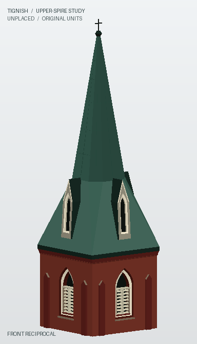

# St. Simon & St. Jude · detached upper spire study

**An original, unplaced, dimensionless Three.js specimen.** The real church's projecting red-brick belfry, narrow green spire and little gabled openings are recognizable in both dated photos. This study describes those features, not the whole building or its exact measurements. It does not change the current flight scenery.



## Exterior construction

A broad flared skirt with rising corner faces meets the long narrow needle above a dark eave. The cut-off upper belfry uses solid pairs of tilted louvres instead of painted stripes. Their caps are embedded in shaded jamb liners and a central mullion, with continuous head and heel bearings. The little hood cheeks are less bulky at the top. Each has a closed back entirely buried in the folded shell, a separate seated thin rake board, and a still-visible deep opening. The fourth side is a plain geometric closure, not an observation. The simplified finial, styling, stage proportions, count of samples and local axes are not measured inventory or a placement proposal.

The mesh has **1,904 emitted triangles in two material batches**, with no external textures or extra transparency/caster work. The 425 unchanged authored triangles retain their exact geometry and tints, including the primary shell, terminal, ledge, brick boundaries and plain closure. Tests check all 48 closed and seated slats, three closed hood bodies and rake boards, continuous concealment under the whole folded skin, and independent positive/negative Three.js first-hit rays. The two [reciprocal](evidence/front-reciprocal.png) [stage views](evidence/front-flank.png) and the [unseen return control](evidence/return-unseen.png) are CPU plates made from emitted positions, normals and original colours. They are not photos, WebGL flight screenshots or FPS evidence. [Verification receipt](evidence/receipt.json) · [Numerical plate check](evidence/plate-proof.json).

## Sources and limits

The [2013 Thelma A Phillips photograph (CC BY-SA 3.0)](https://commons.wikimedia.org/wiki/File:St._Simon_and_St._Jude_Roman_Catholic_Church.jpg) and [2025 Quintin Soloviev oblique photograph (CC BY 4.0)](https://commons.wikimedia.org/wiki/File:St._Simon_%26_St._Jude_Church_(Tignish).jpg) establish visible motifs only. A [parish history](https://regporter.com/pei/wp-content/uploads/2019/03/Cran-Parish-of-Tignish.pdf#page=44) records a 1926 copper re-covering, not the current sheet alloy, repairs or profile dimensions. No photo pixels or traced assets are included.

Neither original is geometrically lens/crop calibrated for this reconstruction. No independently surveyed, common, recognizable 3D landmark qualifies in both images. The measured nave interior surfaces and side joins are not known physical photo targets. The older image has no GPS tags; conflicting altitude/reference information in the newer image cannot be made into a site datum by changing its sign. No scale, height, bearing, span/footing position, site contact or release follows. The unsupported original tower/spire survey roles remain on hold; this upper architectural specimen is separate from those measurements.

## Repeat the detached proof

From the **repository root**, with the normal Three.js dependencies installed and Python 3 with NumPy and Pillow:

```sh
node --experimental-strip-types tools/art/tignish-simon-jude-study/spire/prove.mjs --out ./tignish-spire-proof
```

Choose a new directory each time. The command refuses to overwrite an existing output, even after a failed run. It requires no image downloads or browser. The resulting folder includes verification, exact emitted geometry, three CPU plates and a local receipt. Passing the proof does not qualify any renderer or live route.
