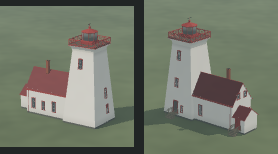

# Wood Islands Lighthouse exterior study

An original standalone Three.js/TypeScript interpretation of the post-relocation lighthouse. The tapered square tower, keeper's gable wing, coved gallery and glazed lantern replace the *look* of a generic silhouette in this independent studio, not the game asset. There is no scene registration, terrain/shore work, navigational light, third-party texture, photo or map imagery. The separate range lights, former fog balcony, museum signage and unseen current details are excluded.

## What the sources support

[Parks Canada's Federal Heritage record](https://www.pc.gc.ca/apps/dfhd/page_fhbro_eng.aspx?id=4673) describes the taper, keeper's wing, shingle cladding, square cross-braced gallery, coved cornice, polygonal metal/glass lantern and chimney. The [PEI Lighthouse Society](https://peilighthousesociety.ca/index.php/history/lighthouses/wood-islands) describes the approximately 6.3 m square tower base and 8 × 4.8 m keeper dwelling, approximately 7.6 m to the wing ridge, and [its current-structure page](https://peilighthousesociety.ca/index.php/lighthouses/open-lighthouses/61-wood-islands-lighthouse) describes the 2009 relocation, octagonal lantern and approximately 16.5 m total height. The [Canadian Coast Guard's listing 976/H0962](https://notmar.gc.ca/publications/list-lights/atl/atl942-en.php) gives a separate 15.3 m structure height and a separate light elevation; the 16.46 m artwork tip follows the approximate tip measurement, not a world elevation or an exact survey. The official records and dated 2011–26 observed reference credit, licenses and limits are in `SOURCES.json`.

Fifteen backed out-of-plane openings and eight distinct lantern panes were authored as geometry, not paint over a box. Recesses, sash/stair dimensions, unknown surfaces and materials are interpretive. Asymmetric visible openings are not mirrored onto an unobserved upper wall. The surface response uses original filtered shingle relief, paint weathering and recessed reflection, not copied colour or imagery. The assembly uses conventional component intersections; it is not one watertight solid or an interior model.

## See it at its apparent size



- [Harbour-side full frame](evidence/harbour-side-1x.webp) and [keeper-side full frame](evidence/keeper-side-1x.webp): actual **1200 × 760** software-rendered studio frames at 126.969 m / 125.016 m lens range, with separately captured silhouette masks.
- [Keeper-side structure close-up](evidence/keeper-structure-crop.webp): unscaled detail crop at approximately 27 m.
- One subject draw, **4,160 triangles**, no textures. The second draw is the plain studio floor. The saved frames are native resolution (1:1 pixel crops), from a real 4-sample Mesa GLES attachment after r187 shader expansion. They are not screenshots from a route. The retained first-light receipt and final receipt show exact packed geometry and marker equality; the capture regenerates both detailed views as well as the two whole flight-scale frames.

## Inspect or reproduce

For local inspection only, call `makeWoodIslandsDetached()` from `wood-islands.ts`; it returns a parentless local-metre `mesh` and `dispose()`. The original studio uses the `woodSunLocal` uniform, fixed axes and the tested typed geometry attributes. It never changes the host scene. The stock-source audit is a separate read-only process.

From the repository root with its dependencies installed (Node 24, Three.js 0.187.0, TypeScript 5.9), and for capture on Linux with Mesa EGL/GLES and Python 3 NumPy/Pillow:

```sh
d=tools/art/wood-islands-exterior
./node_modules/.bin/tsc -p "$d/tsconfig.json"
node --experimental-transform-types --test "$d/wood-islands.test.mjs"
bash "$d/capture.sh" ./wood-islands-new-capture # choose a fresh directory
python3 "$d/compare-capture.py" ./wood-islands-new-capture
node --experimental-transform-types "$d/stock-context.mjs" . # optional stock CPU audit, JSON on stdout
(cd "$d" && sha256sum -c SHA256SUMS)
```

The capture needs no browser, internet, unavailable reference bytes or bundled image input. It refuses an existing output directory. Actual captures record the driver, exact expanded shaders and submitted attributes. A same-environment replay reproduced the archived decoded colour and marker pixels exactly; lossless WebP file bytes can differ despite that. The comparator intentionally checks decoded pixels and exact submitted words. Other drivers may render numerical differences. The manifest verifies the frozen package files separately.

## Why it isn't in the game

The shipped q1010/84 feature is a credible locator and a generic 2020 automated roof outline, **not** a surveyed plan of post-relocation walls. Local CPU replay found a flat six-triangle cap, span `[5622,5688)` in the owner. Its 15.59 m maximum plan diameter is less than the 16.70 m detached envelope and the 16.48 m illustrated floor-support span. No rigid unscaled placement fits the entire art inside that ring; shrinking/clipping it would delete real form. The original 21-21 visual N112 surface and original ground contact differ by up to 0.51 m within the stock ring. A separately registered post-move plan and floor/support datum, co-owner/road clearance for the *actual* full envelope, and a genuine ordinary in-game matched view are missing. Nearest registered default start is more than 25 km away. See `STOCK-CONTEXT.json` for the exact CPU source/word receipt. No game geometry, contact, navigation or terrain was changed.
